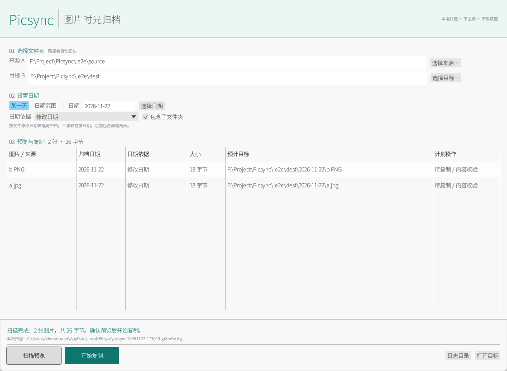

# Picsync · 图片时光归档

中文 Windows 图片整理工具。按一天或日期范围筛选图片，复制到目标目录的每日文件夹，不移动、不删除原图。图片只在本机处理，不上传。

[应用介绍](https://zimplexing.github.io/Picsync/) · [下载 Windows x64 版本](https://github.com/zimplexing/Picsync/releases/latest)



## 使用

1. 解压发布包，双击 `picsync.exe`（建议 Windows 10/11 x64）。
2. 选择来源文件夹 A 和目标文件夹 B，两者不能相同或互为父子目录。
3. 选择“某一天”或“日期范围”，使用日历或输入 `YYYY-MM-DD`。
4. 点击“扫描预览”，检查日期依据、来源和预计目标；悬停在表格文本上查看完整路径和计划操作。
5. 点击“开始复制”。结果如 `B\2026-11-22\IMG_0001.jpg`。复制时再次检查重名，预览文件名可能调整。
6. 任务结束后查看成功/跳过/失败数量；展开“结果与提示”，或打开“日志目录”查看完整记录。

来源、目标、日期依据和是否扫描子目录会自动保存。每次启动日期默认今天，避免误用旧日期。路径失效时重新选择即可。

## 日期规则

- 默认读取 EXIF `DateTimeOriginal`，缺失或无法解析时回退为文件修改日期；预览明确显示日期来源。
- 可以直接选择修改日期或创建日期。创建日期无法读取时，该文件报告失败，不静默替代。
- EXIF 按照片所记录的日历日期归档，不擅自换算时区；文件日期按电脑本地时区解释。筛选和文件夹命名采用同一日期。
- 日期范围包含开始日与结束日全天。

## 安全规则

- 默认扫描子文件夹，跳过链接/重解析点，不保留来源子目录结构。
- 同日同名且 SHA-256 相同则跳过；内容不同则使用 `照片 (1).jpg` 等编号，绝不覆盖原有文件。
- 再次运行也检查编号副本，避免重复复制。不同名称或不同日期不做全局去重。
- 先写入目标目录的本任务临时文件，完成后不覆盖地提交，尽量保留修改及访问时间。
- 扫描后文件大小/修改时间发生变化时跳过，需重新扫描。不承诺在外部程序并发修改文件时获得文件系统快照。
- “取消任务”保留已经完成的图片，停止后续工作并清理本任务未完成的临时文件；不提供整批回滚。
- 权限、文件占用、过长路径等错误会报告；磁盘满或目标整体不可用时停止。临时文件无法清理会提示，不擅自删除其他文件。
- 扫描会在目标或其最近存在的父目录创建并立即删除一个可写性探针，不会写入归档图片。

## 格式范围与限制

按扩展名识别 JPG/JPEG、PNG、TIF/TIFF、WebP、BMP、GIF、HEIC/HEIF（不区分大小写）。复制原始字节，不解码、不转码，也不修复损坏图片。扩展名是候选筛选依据，不是图片有效性认证。

EXIF 读取能力由解析库决定，不保证每种相机、每种容器或私有元数据都支持；不能解析时采用修改日期。首版不支持视频、RAW 专用处理、缩略图图库、定时任务和实时监听。

Windows 长路径、网络盘、云盘占位文件受操作系统和存储提供程序限制。链接/重解析点会被保守跳过，云盘图片建议先下载到本地普通目录。读文件可能导致系统更新访问时间，应用不会有意改写原图内容及修改时间。

## 配置与日志

位于 `%LOCALAPPDATA%\Picsync`（界面的“日志目录”可打开），包括 `settings.json` 和每次任务的日志。配置损坏或版本过新时提示并恢复默认值；只有在你修改设置后才会替换原文件，旧文件会另存为 `settings-recovery-*.json`。日志包含本地文件路径，不包含图片内容；分享日志前请注意隐私。

## 从源码构建

需要 Rust 1.85 或以上、MSVC x64 C++ Build Tools 和 Windows SDK。工程不使用前端或 WebView。

```powershell
cargo test --locked
cargo fmt --all -- --check
cargo clippy --locked --all-targets -- -D warnings
cargo build --release --locked
```

完整发布包生成方式见 `scripts/build.ps1`（含格式检查、43 项自动化测试、Clippy、Release 构建、依赖许可收集和 ZIP 打包）。发布采用静态 CRT；使用系统 Windows/OpenGL 组件，正常使用不需要安装 Rust 或 .NET。`picsync.exe --smoke-test` 启动图形界面并在约两秒后自动退出，用于构建后的启动检查。

构建会把应用图标和版本信息写入 `picsync.exe`（资源管理器、任务栏和窗口标题图标一致，属性中显示“Picsync 图片时光归档”）。这一步调用 Windows SDK 的 `rc.exe`，可用环境变量 `PICSYNC_RC` 指定；如果找不到，构建仍会成功，只是 exe 不带图标。图标与应用内左上角标识由 `src/icon.rs` 中的同一段代码绘制。

`scripts/e2e.ps1` 在真实的临时目录和真实窗口中执行“扫描 → 复制 → 再次运行去重”的界面级验证，并断言源文件哈希未变、日期筛选与归档目录正确。它只操作项目内的 `.e2e` 目录以及 `%LOCALAPPDATA%\Picsync` 配置，运行前请确认后者没有你需要保留的配置。

## 字体与第三方许可

中文字体为 Noto Sans SC，字体文件来源：
https://github.com/google/fonts/tree/main/ofl/notosanssc

遵循 SIL Open Font License 1.1，发布包附 `OFL.txt`。Rust 依赖及默认字体的许可信息由打包脚本收集至 `THIRD_PARTY_NOTICES.txt`。应用源码采用 MIT 许可。
